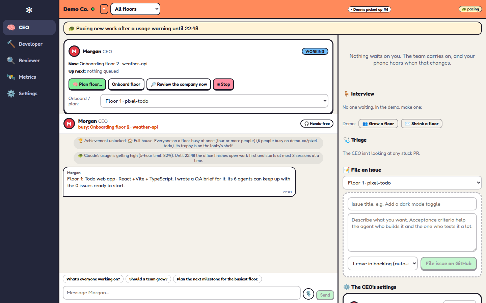
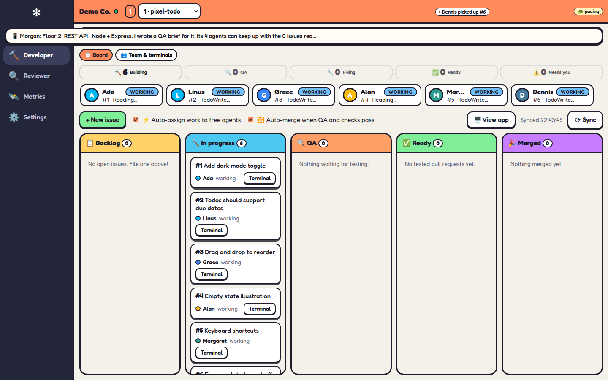
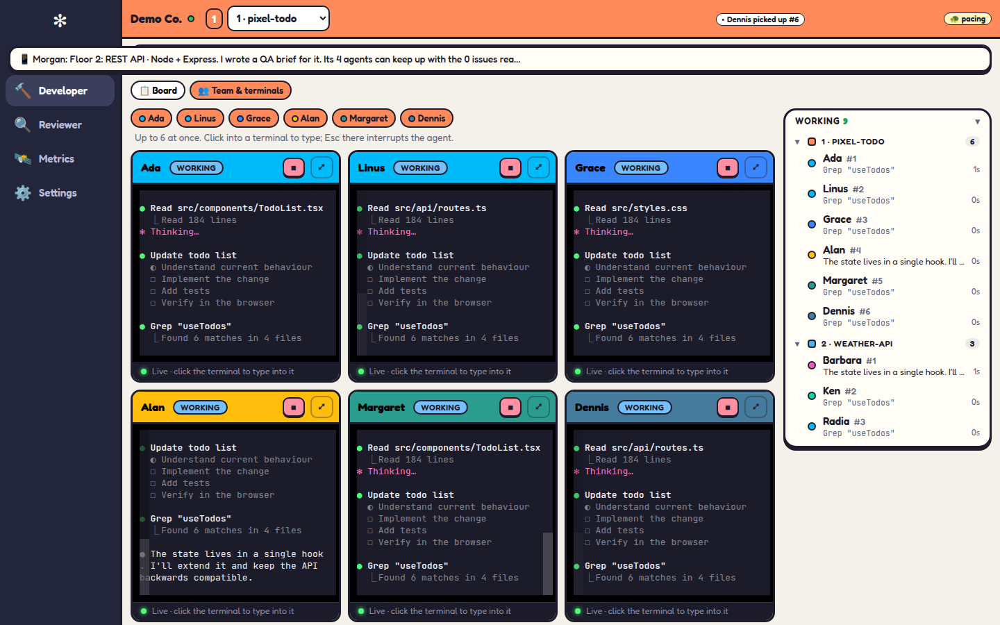
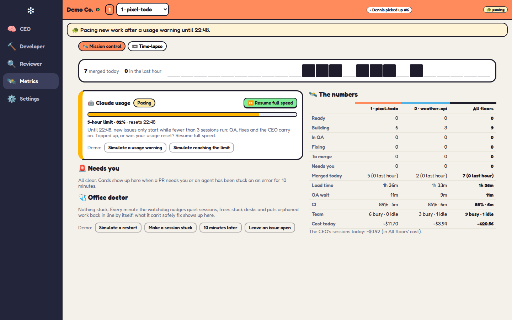

# ✻ cubefarm

A team of AI coding agents works through your GitHub issues. You run it from a 2D dashboard: the CEO takes your brief and
plans the work, the developer board shows what each agent is building, the reviewer checks every pull request and the
metrics show how each floor is doing.

Every agent is a real coding agent, **Claude Code, Codex or OpenCode**, running in a terminal of its own on your machine with your logins, settings, skills and MCP servers. Run the whole team on one, or give each agent its own. The office hands out the work, has every pull request reviewed and tested in a real browser, and merges what passes.

## This fork

This is `supermini/AI-cubefarm`, a fork of [leonvanzyl/cubefarm](https://github.com/leonvanzyl/cubefarm).

- **A 2D dashboard instead of the 3D office.** The CEO, Developer, Reviewer, Metrics and Settings are screens of their own, each with its own address (see [The dashboard](#the-dashboard)). The 3D office, its physics, photo mode and toys are gone, and the client no longer uses three.js.
- **The server is kept close to upstream.** `server/` stays as close to upstream as possible, so fixes made upstream merge in cleanly. Keep the upstream remote and take the `server/` commits you want:

  ```bash
  git remote add upstream https://github.com/leonvanzyl/cubefarm.git   # once
  git fetch upstream
  git log --oneline HEAD..upstream/main -- server/                     # what's new on the server
  git cherry-pick <commit>                                             # one at a time, or a range
  ```

  Don't merge `upstream/main` as a whole: it brings the 3D client back. If a cherry-picked commit touches `shared/`, run `npm run build` to check the dashboard still compiles.
- **Not published.** The npm package `cubefarm` and `npx cubefarm` are upstream's. This fork runs from source.
- **The server runs without the client.** `server/index.ts` serves `dist/` only when it exists. Without `npm run build` the server is API-only: REST and the websocket, and no page. There is no separate headless mode. Use `npm run dev` for the client with Vite, or build first.

## Run it from source

You need Node.js 22 or newer, git, and the GitHub CLI (`gh auth login`). Claude Code comes with cubefarm, and Codex and OpenCode are optional; see [What you need](#what-you-need).

```bash
npm install
npm run build     # the client (dist/) and the server (dist-server/)
npm start         # the office at http://127.0.0.1:4317
```

Or look around first, with fake GitHub and fake agents that cost nothing and change nothing:

```bash
npm run demo      # the server on 4317, the client (Vite) on 5317: open http://localhost:5317
```

`npm run dev` runs the server from source with Vite and restarts the server when `server/` or `shared/` changes. The
launcher behind `npm start`, `npm run dev` and `npm run demo` (`scripts/office.mjs`) can update the checkout from its
`origin` once the office has finished its work. With this fork, `origin` is your fork.

### What you need

- **Node.js 22 or newer**: [nodejs.org](https://nodejs.org)
- **git**
- **The GitHub CLI**, signed in: install it from [cli.github.com](https://cli.github.com), then run `gh auth login`
- **Claude Code, signed in**: it comes with cubefarm, so there's nothing to install. Run `node bin/cubefarm.js login` once to sign in with your Claude subscription. It's the default coding agent, and the CEO always runs on it.
- **Codex or OpenCode** (optional): if you have them installed and signed in, any agent can run them instead (see [Coding agents](#coding-agents)).
- **Google Chrome**, for agents that test your app in a browser.

It runs on Windows, macOS and Linux. Not sure you're ready? `node bin/cubefarm.js doctor` checks all of it.

## Your first five minutes

1. **Set up your company.** A short wizard asks your name, names your company and introduces your CEO.
2. **Move in a project.** Pick one of your project folders or a GitHub repo, or start a new one. It gets its own floor. Every project needs to be on GitHub, because issues and pull requests are how the team works.
3. **Let the CEO plan.** The CEO studies the project, writes its QA checklist and sizes the floor's team. New work only ever comes from you: give the CEO a brief (when the project moves in, or later with **Plan**) or message them on the CEO screen, and they turn it into GitHub issues. The CEO never files issues on its own. The CEO's **Approvals** pane is where you set up new agents (coding agent, model, effort) and hire them, or let agents go.
4. **Watch the work.** Agents are interchangeable: a free agent picks up the next issue, builds it on a branch of its own and opens a pull request. Another agent reviews and tests it in a fresh session and a real browser, then posts a report with screenshots on the pull request. If QA fails, the author fixes it and it goes round again. With auto-merge on, a pull request merges itself once QA passes and GitHub's checks are green. Each agent works on a machine of its own (its own clone, worktree and temp folder; see [Agents](docs/agents.md)).

## The dashboard

The dashboard has a rail of roles on a wide screen and a tab bar on a phone. Each screen has its own address, so a link or a reload lands on it. The floor picker in the top bar chooses which floor the screens show.

| Screen | Address | What's there |
| --- | --- | --- |
| 🧠 CEO | `#/ceo` (approvals: `#/ceo/approvals`) | The CEO's status and queue, planning and onboarding, filing an issue, the chat with the CEO, team changes waiting for you, and the PRs the CEO is triaging. |
| 🔨 Developer | `#/dev/2` (all floors: `#/dev`) | One floor's Kanban board, from backlog to merged, and its team. Hand an issue to an agent by dragging it onto them or with **Assign to…**. |
| 👥 Team & terminals | `#/dev/2/terminals` | Up to six agents' live terminals side by side. Click one to type to the agent; `Esc` there interrupts the agent. |
| 🔍 Reviewer | `#/review/1` (one PR: `#/review/1/42`) | The PR queue, grouped by where each PR stands. A PR's QA report, its screenshots, its app beside main, and **Retry QA**, **Send back for a fix**, **Merge** and **Close PR**. |
| 🛰️ Metrics | `#/metrics` | Mission control: Claude's usage and **Resume full speed**, what needs you, the office doctor, and each floor's numbers. The **📼 Time-lapse** tab replays past days. |
| ⚙️ Settings | `#/settings/notifications` | Floors and repos, team, issues, office, notifications, cloud agents, voice and accessibility. |

A drawer opens on the right for the item you picked: an agent's panel (status, terminal, message box, Stop, Setup) or a PR. `Esc` closes it.









## Coding agents

Every agent, the CEO included, is the actual coding-agent CLI in a terminal on your machine. Open an agent in **Team & terminals** to watch their terminal live, click it to type to them, or press `Esc` in it to interrupt. They load your setup the way your own terminal sessions do: your settings, `CLAUDE.md` or `AGENTS.md`, skills, plugins and MCP servers.

| | Claude Code | Codex | OpenCode |
| --- | --- | --- | --- |
| Install | comes with cubefarm: `node bin/cubefarm.js login` | your own, signed in | your own, signed in |
| What the office sees | every step, plus cost and usage | every step, once you trust its hooks | each finished turn |
| Status | the default; the CEO runs it | experimental | experimental |

- **One for everyone, or one each.** Settings → Office sets the default coding agent, its model and the reasoning effort (out of the box: Claude Code with Claude Opus 5.5 at medium effort). Settings → Team, or an agent's ⚙️ Setup in their drawer, changes them for one agent. One subscription is all you need; mixing them (say, Codex agents testing what Claude Code agents wrote) is up to you.
- **Local models.** Codex and OpenCode agents can run a model on your own computer instead of a subscription: give them a model named after its server, `ollama/qwen3-coder`, `lmstudio/<model>`, `llamacpp/<model>` or `omlx/<model>` (see [Local models](docs/agents.md#local-models)).
- **Codex's hooks.** The first time, Codex asks you to review the office's hooks: type `/hooks` in a Codex agent's terminal and press `t` to trust them. Until then the office shows a Codex agent's task rather than each step.
- **Usage.** Agents on the same coding agent share its usage limits. When Claude warns that usage is getting high, the office slows down new work until the window resets. To cap how many agents run at once, set a session limit in Settings → Office.
- **Restarts.** Agents keep working while the office restarts (an update, a crash): their terminals live in a small process of their own and reconnect when the office is back.
- **Cloud agents.** Optionally, agents work in an [Upstash Box](docs/cloud.md) each instead of on your computer, so they finish their task even with the office closed or your laptop shut. Connect your Upstash account in Settings → Cloud; your Claude subscription, API keys and GitHub are set up once for every Box.

More in [How it works](docs/how-it-works.md#agents-terminals).

## What it does

- **Floors**: one per project. Pick one in the top bar, or see all of them at once.
- **The board**: each floor's Kanban board, from backlog to merged. Auto-assign and auto-merge are switches on the board, and **Sync** pulls the latest from GitHub. An issue that says `Depends on #N` waits until #N is closed.
- **Who's doing what**: each agent's status and what they're on, on the board and in the Team & terminals view. The workers list shows every agent's latest step.
- **Your app, running**: every floor can run its app, from the board's **View app**. Any open pull request can run beside main in the Reviewer's **App** tab, with main side by side if you want to compare.
- **Merges**: a merged pull request shows as a toast and moves to the board's Merged column. A chime for merges is off unless you turn it on in Settings → Notifications.
- **Alerts**: each role's badge in the rail counts what waits on you. A pull request that needs you, or an agent stuck on an error for more than 10 minutes, is listed under Needs you in Metrics.

## Around the dashboard

- **The CEO's voice**: hear the CEO's messages read aloud (your browser's voice, or ElevenLabs with your own key), and talk instead of typing: hold `V` or the 🎙️ in any message box. See [Voice messages](docs/voice.md).
- **Pocket mode**: on a phone, the dashboard is the same app with a tab bar at the bottom. It installs on your home screen and can notify you when something needs you. See [The dashboard in your pocket](docs/pocket.md).
- **Time-lapse**: watch a past day replay at up to 600×, from the Metrics screen's 📼 Time-lapse tab. A bar at the bottom pauses, changes speed and jumps along the timeline.
- **Accessibility**: captions for the office's sounds, colour-blind-safe status colours and shapes, motion comfort, UI scale, a readable font and high contrast (Settings → Accessibility).

## Commands

| Command | What it does |
| --- | --- |
| `npm install` | install the dependencies |
| `npm run build` | typecheck, build the client into `dist/` and the server into `dist-server/` |
| `npm start` | start the built office under the launcher, at `http://127.0.0.1:4317` |
| `npm run dev` | the server from source plus Vite (the client at `http://localhost:5317`), restarted on changes |
| `npm run demo` | as `npm run dev`, with fake GitHub and fake agents |
| `node bin/cubefarm.js --demo --floors 10 --agents 15` | a big demo company: 10 floors of 15 people, to see the dashboard at scale |
| `node bin/cubefarm.js --port 4400` | use another port (the default is 4317) |
| `node bin/cubefarm.js --host 0.0.0.0` | listen on your network too, not just this computer (no sign-in: see below) |
| `node bin/cubefarm.js --no-open` | don't open the browser |
| `node bin/cubefarm.js doctor` | check that your machine is ready |
| `npm test`, `npm run typecheck` | the tests and the type check |

## Updating

Run `git pull` in this checkout, then `npm install` and `npm run build`. The launcher (`npm start`, `npm run dev`, `npm run demo`) also updates the checkout from its `origin` by itself once the office has finished its work: see [Updating the office](docs/how-it-works.md#updating-the-office). To take upstream's server fixes, see [This fork](#this-fork).

## Good to know

- **It runs on your own subscriptions.** Each agent uses the login of the coding agent it runs, and agents on the same coding agent share its usage limits.
- **Agents work like the coding agents you run yourself**: unsandboxed, with your skills, MCP servers and settings, each in its own copy of the repo. Nobody has to be there to approve a tool call, so the office approves them all: run it where you'd run your own coding agents. The office's rules are in the agents' instructions: push your own branch and open a pull request, never push to your main branch or merge. The office merges, after QA.
- **Your office lives in `~/.cubefarm`**: settings, clones of your repos and one machine (a clone and a worktree) per agent. Set `SWARM_HOME` to use another folder. Machines nobody uses any more are swept away every 30 minutes, and any unpushed work on them is kept as a patch in `~/.cubefarm/leftovers`.
- **It's only open to your own computer.** The office listens on `127.0.0.1`. To reach it from your phone, put something that signs you in in front of it, like Tailscale Serve: see [Reach the office from your phone](docs/pocket.md#reach-the-office-from-your-phone). `--host 0.0.0.0` (or `SWARM_HOST`) opens it to your network as it is, say to run it on a Mac mini and watch from your laptop: the office has no sign-in, so anyone who can reach it can run your agents. Only do that on a network you trust.

## Learn more

- [How it works](docs/how-it-works.md): the life of an issue, QA, auto-merge, models and usage, agents' terminals, the safety model and floor previews
- [Agents](docs/agents.md): interchangeable agents, team sizes and the CEO's team changes, each agent's machine and how it signs in
- [Cloud agents](docs/cloud.md): agents in Upstash Boxes that keep working while the office is closed: setup, sign-in, costs and limits
- [The dashboard in your pocket](docs/pocket.md): pocket mode on your phone, installing the app, notifications (desktop, push, ntfy) and reaching the office safely from your phone
- [Voice messages](docs/voice.md): the CEO's messages read aloud, ElevenLabs voices and talking instead of typing
- [Contributing](CONTRIBUTING.md): run it from source, tests, architecture and publishing

## License

[MIT](LICENSE). Copyright (c) 2026 Leon van Zyl (upstream); this fork's changes are copyright (c) 2026 Paulo Lopes.
